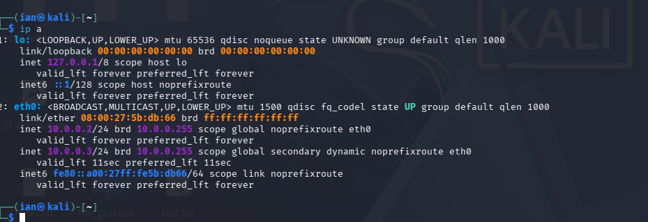

Week 1 Project: Cybersecurity Lab Setup

 Project Overview
This project focuses on setting up a virtual cybersecurity and penetration-testing laboratory using VirtualBox and Kali Linux. The purpose of the lab is to create a controlled environment where cybersecurity tools, network scanning, reconnaissance, vulnerability assessment, and other security-testing activities can be performed safely and repeatedly.

 Lab Configuration
- Host Machine: Windows [windows 10]
- Hypervisor: VirtualBox (Latest Version)
- Attacking Machine:Kali Linux
- Network Setup: NAT Network (10.0.0.0/24)
- Kali Linux IP Address: 10.0.0.2/24
- Features Enabled: Bidirectional Clipboard, Drag and Drop, and Shared Folders (Downloads).

Troubleshooting Experience
During the setup, I encountered an issue where the Kali Linux VM was not receiving an IP address after changing the network adapter to NAT Network. The connection kept failing with an "IP configuration could not be reserved" error. 

Solution:I resolved this by opening the terminal and using the `nmcli` command to manually assign the static IP address (`10.0.0.2/24`) and setting the IPv4 method to manual. I then brought the connection down and back up, which successfully established the network connection and allowed full internet access.

 📸 Lab Evidence

